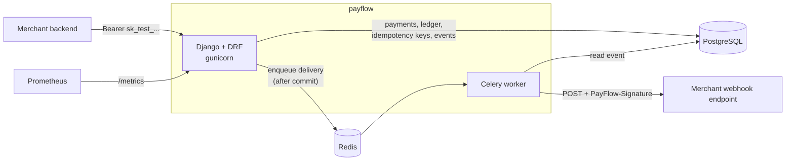

# payflow-api

A small payments API in Django REST Framework. Merchants sign up, get an API key and
charge (simulated) cards. Every money movement is written to a double-entry ledger, POST
requests can be retried safely with an `Idempotency-Key`, and merchants are notified
through signed webhooks delivered by Celery.

The goal was to work through the problems a real payment backend has to get right
(duplicate requests, concurrent refunds, money that always adds up, reliable
notifications) without the noise of a real card network.

## Architecture



Code layout:

| App | What it holds |
| --- | --- |
| `merchants` | Merchant model, API keys (hashed), bearer authentication |
| `payments` | Card simulator, payments, refunds and their services |
| `ledger` | Accounts, transactions, entries; posting and balance logic |
| `webhooks` | Endpoints, events, deliveries, HMAC signing, Celery task |
| `core` | Error format, idempotency decorator, throttles, pagination, health, metrics |

Views stay thin: they validate input and call a function in `services.py`, which owns the
database transaction.

## Running it

### With Docker

```bash
cp .env.example .env
docker compose up --build
```

This starts Postgres, Redis, a one-shot `migrate` container, the API on
http://localhost:8000 and a Celery worker. Swagger UI is at http://localhost:8000/docs.

To see webhooks arrive, start the demo receiver as well and register
`http://webhook-receiver:9000/hooks` as an endpoint:

```bash
docker compose --profile demo up webhook-receiver
```

### Without Docker

```bash
python -m venv .venv
.venv/bin/pip install -r requirements-dev.txt     # .venv\Scripts\pip on Windows
export CELERY_TASK_ALWAYS_EAGER=1                   # run webhook tasks inline, no Redis needed
python manage.py migrate
python manage.py runserver
```

Without `DATABASE_URL` the app uses SQLite.

### Tests

```bash
pytest
ruff check . && ruff format --check .
```

Tests run on SQLite locally. CI runs them against PostgreSQL 16, where `select_for_update`
actually takes row locks.

## Quick tour

```bash
# 1. Sign up. The key is only shown once.
curl -s -X POST localhost:8000/v1/merchants \
  -H 'Content-Type: application/json' \
  -d '{"name": "Atlas Shop", "email": "owner@atlas.ma"}'

export KEY=sk_test_...

# 2. Charge 250.00 MAD. Retrying with the same key returns the same payment.
curl -s -X POST localhost:8000/v1/payments \
  -H "Authorization: Bearer $KEY" -H 'Content-Type: application/json' \
  -H 'Idempotency-Key: order-1042' \
  -d '{"amount": 25000, "currency": "MAD",
       "card": {"number": "4242424242424242", "exp_month": 12, "exp_year": 2030, "cvc": "123"}}'

# 3. Refund part of it, then check the balance.
curl -s -X POST localhost:8000/v1/payments/<id>/refunds \
  -H "Authorization: Bearer $KEY" -H 'Content-Type: application/json' -d '{"amount": 5000}'
curl -s localhost:8000/v1/balance -H "Authorization: Bearer $KEY"
```

Test cards:

| Number | Result |
| --- | --- |
| `4242424242424242`, `5555555555554444`, `378282246310005` | Approved |
| `4000000000000002` | `card_declined` |
| `4000000000009995` | `insufficient_funds` |
| `4000000000000069` | `expired_card` |
| `4000000000000127` | `incorrect_cvc` |
| Any number failing the Luhn check | 400 validation error |

## API overview

All amounts are integers in minor units (`25000` = 250.00 MAD). Supported currencies:
MAD, EUR, USD.

| Method | Path | Notes |
| --- | --- | --- |
| POST | `/v1/merchants` | Sign up, returns the API key once. No auth. |
| GET | `/v1/merchants/me` | |
| POST | `/v1/payments` | Idempotent. 201 on success, 402 on decline. |
| GET | `/v1/payments` | Cursor pagination, `?status=`, `?limit=` |
| GET | `/v1/payments/{id}` | |
| POST | `/v1/payments/{id}/refunds` | Idempotent. Omit `amount` to refund the rest. |
| GET | `/v1/payments/{id}/refunds` | |
| GET | `/v1/balance` | Available balance per currency, read from the ledger |
| GET | `/v1/events` | `?type=payment.succeeded` |
| GET | `/v1/events/{id}` | |
| POST, GET | `/v1/webhook-endpoints` | Creation response includes the `whsec_` secret |
| GET, PATCH, DELETE | `/v1/webhook-endpoints/{id}` | |
| GET | `/v1/webhook-endpoints/{id}/deliveries` | Attempts, last status code, next retry |
| GET | `/health`, `/health/live` | Readiness (checks the DB) and liveness |
| GET | `/metrics` | Prometheus |
| GET | `/docs`, `/v1/schema` | Swagger UI and OpenAPI 3 schema |

Every error has the same shape:

```json
{"error": {"type": "card_error", "code": "insufficient_funds",
           "message": "The card has insufficient funds.", "payment": "6f37..."}}
```

`type` is one of `invalid_request_error`, `authentication_error`, `card_error`,
`not_found_error`, `conflict_error`, `idempotency_error`, `rate_limit_error`, `api_error`.
Validation errors add a `fields` object.

## Design decisions

**API keys are hashed with SHA-256, not bcrypt.** A key is 32 random bytes, so there is
nothing to brute force; a slow hash would only add latency to every request. Only the hash
and a short display prefix are stored, and lookup is a single indexed query on the hash.

**Card data.** The full number only lives in memory during the request. The database keeps
brand, last 4 digits and expiry. The idempotency table stores a SHA-256 fingerprint of the
request, not the body, for the same reason.

**Idempotency.** The first request inserts an `(merchant, key)` row in its own transaction.
The unique constraint decides who wins if two identical requests race. The winner runs the
view and stores the status code and body. Then:

- same key, same fingerprint, finished: the stored response is replayed with
  `Idempotent-Replayed: true`;
- same key, different body: 422, because that is a client bug;
- same key, still running: 409.

Only responses that changed state are stored (2xx, and 402 because a declined charge still
creates a failed payment). On validation errors, exceptions or 5xx the row is deleted so
the client can fix the request and retry with the same key. Keys expire after 24 hours
(`purge_idempotency_keys`). If the process dies between the payment commit and the
response being saved, the key stays `in_progress` and retries get a 409 until it expires.
That is a safe failure: the client is never charged twice.

**Double-entry ledger.** A balance is never a column you update. It is the sum of
immutable ledger entries, and every transaction must have equal debits and credits or
`post_transaction` refuses it before touching the database.

| Event | Debit | Credit |
| --- | --- | --- |
| Charge of 250.00, fee 4.75 | `processor_clearing` 250.00 | `merchant_balance` 245.25, `platform_fees` 4.75 |
| Refund of 50.00 | `merchant_balance` 50.00 | `processor_clearing` 50.00 |

Fees are not returned on refunds. `python manage.py verify_ledger` checks that every
transaction balances and that each currency sums to zero; CI runs it. Computing balances
by summing entries is fine at this scale. A bigger system would keep a running balance
updated in the same transaction, or snapshot it periodically.

**Refunds and locking.** `refund_payment` reads the payment with `select_for_update()`
inside the transaction. Two concurrent refunds on the same payment are serialized by
PostgreSQL, so the second one sees the updated `amount_refunded` and cannot over-refund. A
check constraint (`amount_refunded <= amount`) backs this up at the database level.

**Webhooks.** The event and its delivery rows are written in the same transaction as the
payment. The Celery task is enqueued with `transaction.on_commit`, so a rolled back
payment never produces a webhook, and a worker never looks for a row that does not exist
yet. Each delivery is signed:

```
PayFlow-Signature: t=1763560000,v1=5f2c...e81a
v1 = hex(HMAC-SHA256(secret, "<t>.<raw body>"))
```

The timestamp is part of the signed message, so a receiver can reject anything older than
a few minutes (replay protection). `webhooks/signing.py` has the verification function, and
`scripts/webhook_receiver.py` shows it from the receiver's side. Failed attempts are retried
with exponential backoff and jitter (30 s, 1 min, 2 min, … capped at 6 h) up to
`WEBHOOK_MAX_ATTEMPTS`. The attempt counter lives in the database, not in Celery, so it
survives worker restarts. Deliveries are at-least-once: receivers should deduplicate on
the event id (`PayFlow-Event-Id` header).

**One gunicorn process per container.** The image runs one gthread worker with 8 threads.
Prometheus client metrics are per process, so this keeps `/metrics` accurate without the
multiprocess mode. To scale, add replicas.

**Health checks.** `/health/live` does not touch any dependency, so a database outage does
not get every pod restarted. `/health` checks the database and is meant for readiness.

## Known limitations

- Webhook URLs are not checked against private IP ranges (SSRF). A production version
  would resolve the host and refuse internal addresses.
- One API key per merchant; there is no key rotation endpoint yet.
- The card simulator approves any Luhn-valid number that is not a declining test card.

## Configuration

See `.env.example`. Main variables: `DATABASE_URL`, `CELERY_BROKER_URL`,
`DJANGO_SECRET_KEY`, `DJANGO_ALLOWED_HOSTS`, `PAYFLOW_FEE_PERCENT`, `PAYFLOW_FEE_FIXED`,
`WEBHOOK_MAX_ATTEMPTS`, `THROTTLE_MERCHANT_RATE`.

Deployment manifests for Kubernetes live in
[gitops-platform](https://github.com/Schaib03/gitops-platform).
